# A Guide to ADA Robot-Assisted Feeding

This guide is for anyone who has never seen this codebase and needs to understand it well enough to change it. Read sections 1 to 5 first. They take about 30 minutes and cover how everything fits together. Sections 6 to 11 are reference, so come back to them when you work on a specific part.

It describes `ada_feeding` after the Milestone 0 changes (issues #221, #222, #223), in which the web app moved into this repository. It was written from the code at the commits in [`ada.repos`](https://github.com/personalrobotics/ada_feeding/blob/ros2-devel/ada.repos), the lab's papers, and running the system in dummy mode. File references are relative to the `ada_feeding` repository unless another repository is named.

**Contents**

01. What this system is
02. Run it in 15 minutes
03. The big picture
04. One bite, end to end
05. Where everything lives
06. The web app
07. The robot side
08. Safety
09. Hardware, run modes, and machines
10. How to contribute
11. Known issues and gotchas
12. Glossary
13. Papers and history

## 1. What this system is

ADA (Assistive Dexterous Arm) is a robot arm mounted on a power wheelchair that feeds people who can't feed themselves. The user picks a bite on a phone or tablet. The robot picks it up from the plate with a fork or spoon, brings it to the user's mouth, and waits while they take it.

The arm is a Kinova JACO2. At its end is the **Articutool**, a small motorized wrist that holds the fork or spoon level and runs short motions like twirling noodles. A camera on the wrist sees the plate and the user's face. The lab has run the system with real users in cafeterias, offices, and a user's home (HRI 2025).

The software has two halves.

- **The web app** (React), which the user taps. It decides what happens next in the meal.
- **The robot software** (ROS 2 Humble), which carries out each step, such as perceiving the food, planning a motion, and moving the arm safely.

They talk over a WebSocket bridge called rosbridge. The rest of this guide explains each piece.

## 2. Run it in 15 minutes

You don't need the robot. **Dummy mode** runs the real web app against fake robot and perception nodes, in Docker, on macOS or Linux.

You need Docker, which is Docker Desktop on macOS or `docker.io` on Ubuntu. On macOS, Docker Desktop may install its command in `~/.docker/bin`, so add that folder to your `PATH`.

You don't need the Kinova SDK either. The build leaves it out unless you pass `--build-arg WITH_KINOVA_SDK=true`, which only the real arm needs (section 9.1).

```bash
git clone https://github.com/personalrobotics/ada_feeding.git
cd ada_feeding
docker build . -t articutool-dev      # the first build takes 20 to 40 min
docker run -it --rm \
  -p 3000:3000 -p 5000:5000 -p 9090:9090 \
  -e CYCLONEDDS_URI='<CycloneDDS><Domain><General><Interfaces><NetworkInterface name="lo" multicast="true"/></Interfaces></General></Domain></CycloneDDS>' \
  articutool-dev
# Then, inside the container
python3 src/ada_feeding/start.py --sim dummy
```

Open `http://localhost:3000`, press **Start Feeding**, and go through a bite. Every robot motion takes about 10 seconds in dummy mode.

To check that everything works without clicking, run the smoke test from the repository root.

```bash
./smoke_test/run.sh
```

It builds the image, plays one full meal through the web app in a headless browser, and prints `PASS` or the step that failed. Its screenshots and a video of the run land in `smoke_test/artifacts/<timestamp>/`. Watching that video is the fastest way to see the whole app.

**The `CYCLONEDDS_URI` line keeps ROS traffic inside the container.** The repository's `cyclonedds.xml` names the robot laptop's Wi-Fi card, which your machine doesn't have, so without the override every ROS process fails to start.

## 3. The big picture

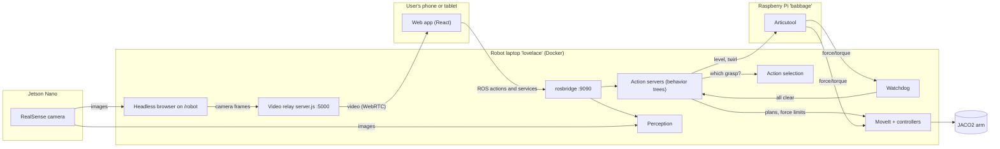

Six ideas explain most of the design.

1. **The web app runs the meal.** The current step of the meal (the *meal state*) lives in the browser, saved in its local storage. The robot has no idea where in the meal it is. It only does what the app asks, one step at a time.
2. **Every robot step is a ROS action.** An action is a request that takes time, reports progress, and can be canceled, such as "move above the plate", "acquire this food", or "move to the mouth". The app calls them directly through rosbridge.
3. **One process does all the robot steps.** `create_action_servers.py` hosts every action server. Each one runs a *behavior tree*, which is a tree of small reusable steps (re-zero the force sensor, plan, execute, clean up). Only one goal runs at a time, across all servers.
4. **Force limits keep the arm safe.** Every arm controller is *force-gated*, which means it stops the arm if the force/torque sensor in the Articutool reads more than a threshold (1 to 4 N for most motions).
5. **A watchdog must keep saying "all clear".** The watchdog (`ada_watchdog`) is a small safety node that publishes "all clear" 60 times a second, as long as force data is flowing and the physical e-stop button hasn't been pressed. If it stops, robot goals are refused and the running one is aborted (section 8).
6. **The user stays in control.** They choose each bite by tapping the image, can pause any motion, and decide when to move on. This was co-designed with users with motor impairments and validated in studies (section 13).

## 4. One bite, end to end

This is what happens in one bite, and which code does it. The meal states are named as in the code (`GlobalState.jsx`). `U_` states wait for the user, and `R_` states wait for the robot.

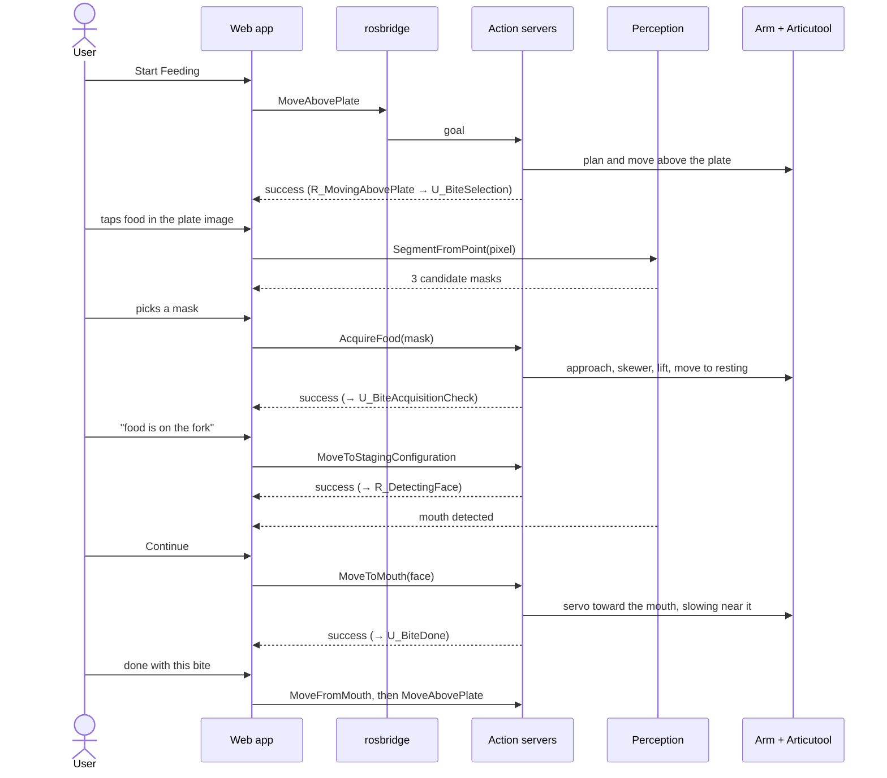

Here are the same steps as a table, with the code behind each one.

| Meal state | What the user sees | What runs | Code |
|---|---|---|---|
| `U_PreMeal` | "Start Feeding" | nothing | `MealStates/PreMeal.jsx` |
| `R_MovingAbovePlate` | "Robot is moving…", Pause | action `MoveAbovePlate` | `trees/move_to_configuration_with_ft_thresholds_tree.py` |
| `U_BiteSelection` | live plate video, where the user taps food and picks a mask, or presses Done Eating | action `SegmentFromPoint` | `MealStates/BiteSelection.jsx`, `ada_feeding_perception` |
| `R_BiteAcquisition` | "Robot is moving…", Pause, Back | action `AcquireFood` | `trees/acquire_food_tree.py` (section 7.3) |
| `U_BiteAcquisitionCheck` | "Is food on the fork?" | food-on-fork detection, whose result is reported to action selection | `MealStates/BiteAcquisitionCheck.jsx` |
| `R_MovingToStagingConfiguration` | "Robot is moving…" | action `MoveToStagingConfiguration` (a pose in front of the face) | `trees/move_to_configuration_with_wheelchair_wall_tree.py` |
| `R_DetectingFace` | video with the detected face, and Continue | face detection | `MealStates/DetectingFace.jsx` |
| `R_MovingToMouth` | "Robot is moving…" | action `MoveToMouth` | `trees/move_to_mouth_tree.py` |
| `U_BiteDone` | "Move above plate / rest to the side / move away" | food-on-fork detection | `MealStates/BiteDone.jsx` |
| `R_MovingFromMouth` | "Robot is moving…" | action `MoveFromMouth` | `trees/move_from_mouth_tree.py` |
| `R_StowingArm` | after Done Eating | action `MoveToStowLocation` | as `MoveAbovePlate` |
| `U_PostMeal` | "Return to Start" | nothing | `MealStates/PostMeal.jsx` |

The 13th state, `R_MovingToRestingPosition`, moves the arm to the side of the user instead of in front of them. The full transition diagram is in section 6.2.

**Pause** cancels the current action (the arm stops and the tree's cleanup runs). **Resume** sends the same goal again. **Back** goes to the previous safe step.

### What the user sees

These screenshots come from the smoke test (section 2), in dummy mode. In the real app, the header's connection badge shows a plug icon, which renders as a box here.

| | |
|---|---|
| 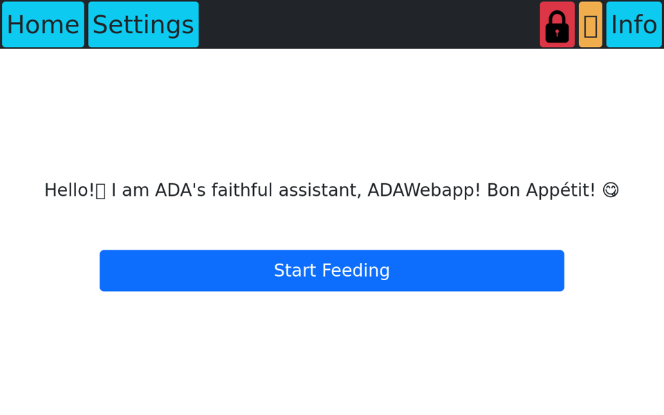 | 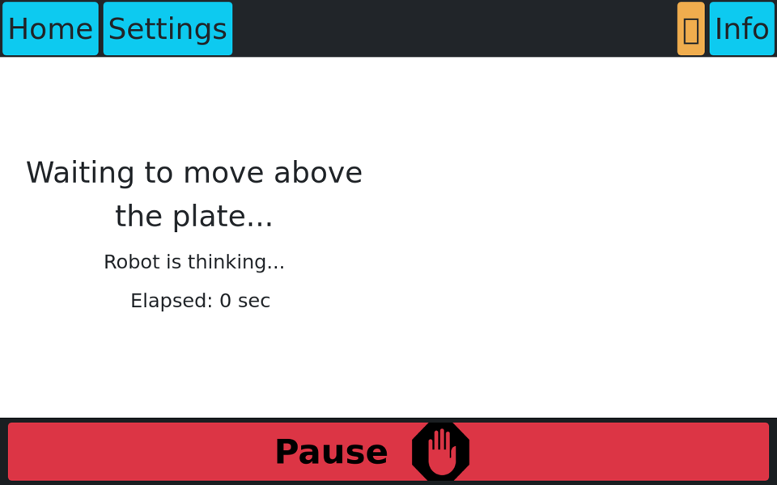 |
| `U_PreMeal`, the start screen | `R_MovingAbovePlate`, or any robot motion, with Pause |
| 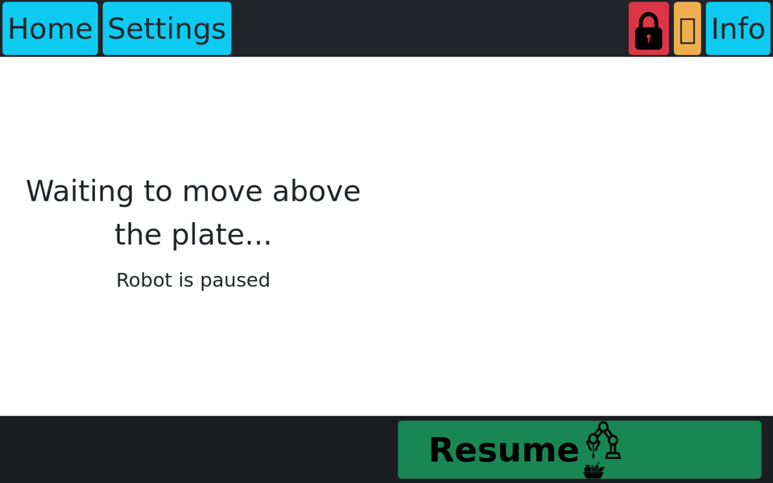 | 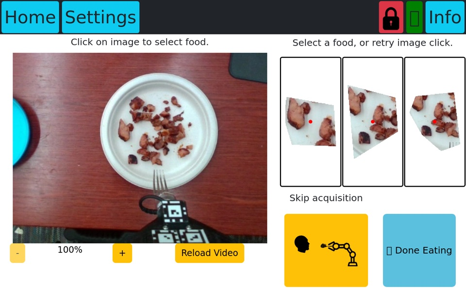 |
| A paused motion, with Resume | `U_BiteSelection`, after the user tapped the plate, with three candidate masks on the right |
| 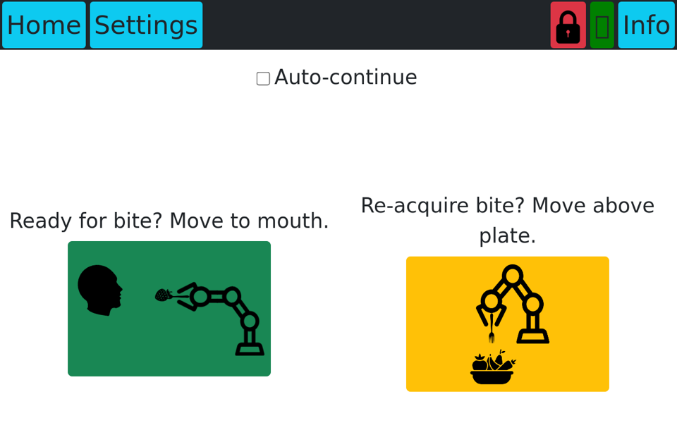 | 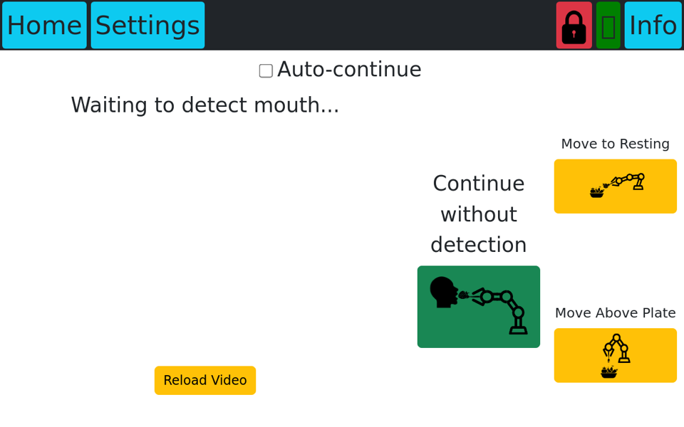 |
| `U_BiteAcquisitionCheck`, to move to the mouth or try again | `R_DetectingFace`, before a mouth is detected |
| 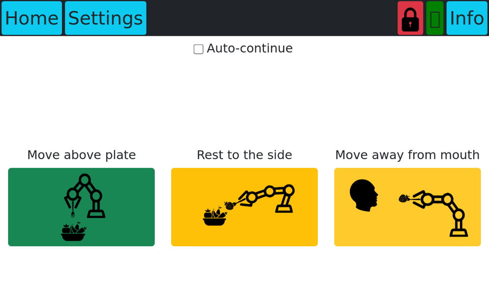 | 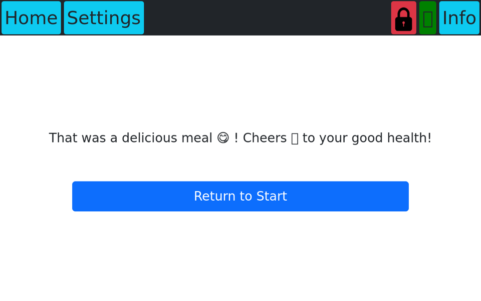 |
| `U_BiteDone`, to choose where to go after the bite | `U_PostMeal`, after the meal is over |

## 5. Where everything lives

### 5.1 Repositories

| Repository | What it contains | How you get it |
|---|---|---|
| **`ada_feeding`** (this one) | The feeding logic, the web app, perception, launch scripts, Docker setup, the smoke test | `git clone` |
| `ada_ros2` | ADA's robot model (URDF), MoveIt configuration, the JACO2 hardware driver, controller configs, camera calibration | pinned in `ada.repos` |
| `articutool_ros2` | The Articutool's model, motor and sensor drivers, orientation control, and motion primitives. It runs on the Raspberry Pi | pinned in `ada.repos` |
| Forks of `moveit2`, `pick_ik`, `pymoveit2`, `py_trees_ros`, `rosbridge_suite`, `cartesian_controllers`, `pr_ros_controllers` | Lab changes to upstream ROS packages | pinned in `ada.repos` |

**`ada.repos`** lists every external repository at an exact commit. `vcs import . < ada_feeding/ada.repos`, run from the workspace's `src/` folder, clones them all next to `ada_feeding`. Pin by commit, never by branch. The old setup pinned branches, two of them were deleted, and the build broke.

### 5.2 Inside `ada_feeding`

```
ada_feeding/
├── ada_feeding/                 The robot-side feeding logic (ROS package)
│   ├── scripts/                 create_action_servers.py (the main node), ada_watchdog.py, ...
│   ├── ada_feeding/trees/       One behavior tree per robot step
│   ├── ada_feeding/behaviors/   Reusable tree steps: MoveIt, servo, Articutool, transfer, ...
│   ├── ada_feeding/idioms/      Patterns built from behaviors (e.g. "always clean up")
│   ├── config/                  Default and per-preset parameters, watchdog config
│   └── launch/                  ada_feeding_launch.xml
├── ada_feeding_msgs/            Action, message and service definitions
├── ada_feeding_perception/      Segmentation, face, food-on-fork and table detection
├── ada_feeding_action_select/   Chooses how to pick up each food (the acquisition library)
├── ada_planning_scene/          Collision objects: wheelchair, table, user's head
├── nano_bridge/                 Moves camera images from the Jetson Nano to the laptop
├── feeding_web_interface/       The web app (moved in from its own repository, with history)
│   ├── feedingwebapp/           The React app, the video relay server.js, the headless browser script
│   ├── feeding_web_app_ros2_test/   Dummy robot and perception nodes for dummy mode
│   └── feeding_web_app_ros2_msgs/   Messages for the dummy nodes
├── start.py                     Launches everything (section 9.2)
├── Dockerfile, ada.repos        How the workspace is built and pinned
├── smoke_test/                  The one-command end-to-end test
├── v2/                          Where the next version is being built (section 10.4)
└── experiments/                 Studies and benchmarks; nothing imports them
```

### 5.3 "Where do I change...?"

| To change | Look in |
|---|---|
| A screen, button, or text in the app | `feeding_web_interface/feedingwebapp/src/Pages/Home/MealStates/` |
| Which states exist and the app's saved state | `src/Pages/GlobalState.jsx` |
| The ROS names the app uses | `src/Pages/Constants.js` |
| How the app calls ROS | `src/ros/ros_helpers.js` |
| What a robot step does | `ada_feeding/ada_feeding/trees/` |
| Poses, speeds, distances, force thresholds | `ada_feeding/config/ada_feeding_action_servers_default.yaml`, with per-preset overrides in `..._custom.yaml` |
| How each food is picked up | `ada_feeding_action_select/config/acquisition_library.yaml` |
| Perception models and parameters | `ada_feeding_perception/` |
| Collision objects around the user | `ada_planning_scene/config/`, `ada_planning_scene/assets/` |
| The watchdog | `ada_feeding/config/ada_watchdog.yaml`, `ada_feeding/scripts/ada_watchdog.py` |
| Controller force gates | `ada_ros2/ada_moveit/config/real_controllers.yaml` (and `mock_controllers.yaml`) |
| The robot model | `ada_ros2/ada_description/`, `ada_ros2/ada_moveit/config/ada.urdf.xacro` |
| Articutool behavior | `articutool_ros2/articutool_control/` |
| Which processes start in each mode | `start.py` |
| Fake robot and perception for dummy mode | `feeding_web_interface/feeding_web_app_ros2_test/` |
| Action and message definitions | `ada_feeding_msgs/action/`, `msg/`, `srv/` |

## 6. The web app

All paths in this section are under `feeding_web_interface/feedingwebapp/src/`.

### 6.1 Structure

- **Two pages, Home and Settings.** The app switches between them through its state, not the URL, so a user can't navigate to a screen that doesn't match what the robot is doing (`App.jsx`).
- **The header** has Settings (only when the robot isn't moving), a lock icon while it's safe to interact, a connection badge for ROS, and an Info button with Video and Teleop tabs.
- **The footer** shows Pause while the robot moves, and Back and Resume while paused.
- **State** lives in one zustand store, `Pages/GlobalState.jsx`, saved to the browser's local storage under `ada_web_app_global_state`. It holds the meal state, pause status, the last goals, teleop speeds, and settings.
- **Other routes** include `/robot`, the page the headless browser opens to relay video (section 6.5), and the developer pages `/test_ros` and `/test_bite_selection_ui/*`.

### 6.2 Meal states

Every `R_` state shows the `RobotMotion` screen, which sends its action as soon as the screen appears. On success it moves to the next state, on cancel it shows "paused", and on error it shows "Robot encountered an error" with **Retry**. There is no central transition table. Each screen hardcodes where it goes next, and `Pages/Home/Home.jsx` maps states to screens.

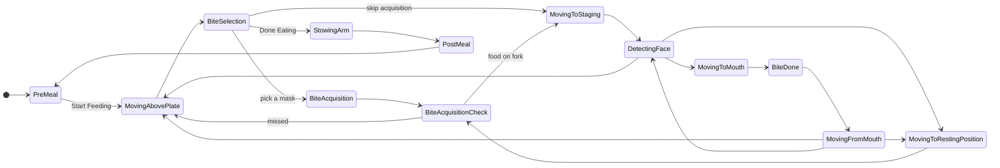

**Auto-continue** (off by default, set in Settings) advances without a tap in three places, which are after acquisition when food-on-fork detection is confident for 3 seconds, after a bite when the fork is empty for 3 seconds, and after a face is detected.

### 6.3 Interruptions, as the user experiences them

| Situation | What happens |
|---|---|
| Pause | The action is canceled and the arm stops. This is a software stop, not a hardware one |
| Resume | The same goal is sent again |
| Back | Goes to the state's "back" target |
| An action fails | "Robot encountered an error" with Retry (clears the collision map, then retries). AcquireFood offers Skip Acquisition instead |
| A result never comes | Nothing. There is no timeout |
| Page refresh during motion | The saved `R_` state reloads and **sends the motion again** |
| Pause, then Settings, then Home | Opening Settings clears "paused", so returning **resumes motion** |
| No activity for an hour | The app resets to the start |

### 6.4 Settings and teleop

- **Settings** edits *presets*, which are named sets of parameters (distance from mouth, speeds, the above-plate, resting, staging, and stow poses, and the planning scene). The `default` preset is read-only. Values are written to the action-server node as ROS parameters, which saves them to `ada_feeding/config/ada_feeding_action_servers_custom.yaml`.
- **Teleop** (Info → Teleop, or inside the pose screens) jogs the arm in Cartesian or joint space at 10 Hz while a button is held. It can raise the force threshold to 75 N and re-zero the sensor.

### 6.5 How the app talks to the robot

**Commands and data** go through rosbridge (port 9090) using the lab's `roslibjs` fork, which adds action support. All calls are in `src/ros/ros_helpers.js`, and all names are in `src/Pages/Constants.js`.

| Kind | Names |
|---|---|
| Actions | `MoveAbovePlate`, `MoveToRestingPosition`, `MoveToStagingConfiguration`, `MoveFromMouth`, and `MoveToStowLocation` take an empty goal. `AcquireFood` takes the chosen mask, `MoveToMouth` the face detection, and `SegmentFromPoint` the tapped pixel. Teleop uses `ActivateController`. There is also `recompute_workspace_walls` |
| Services | `toggle_table_detection`, `toggle_face_detection`, and `toggle_food_on_fork_detection`, because perception runs only when a screen needs it. `ada_feeding_action_select/action_report` reports whether the bite worked. There are also `clear_octomap`, `ft_sensor/tare`, `get_robot_state`, and parameter get and set for presets |
| Topics | The app subscribes to `/face_detection` and `/food_on_fork_detection`, and publishes teleop commands on `/web_app/servo_node/delta_twist_cmds` and `delta_joint_cmds` |

**Video** takes a separate path, because sending images to the browser through rosbridge is too slow.

1. The camera on the Jetson Nano publishes images, which `nano_bridge` sends to the laptop as `/local/camera/...`.
2. `start_robot_browser.js` opens a headless browser on the app's `/robot` page.
3. That page draws the images onto a canvas and streams it to `server.js` (port 5000) over WebRTC.
4. The user's browser asks `server.js` for the stream.

Each stream has one viewer, so a second viewer replaces the first. If the video is blank, press **Reload Video**.

## 7. The robot side

### 7.1 The action-server node

`ada_feeding_launch.xml` starts the watchdog, `create_action_servers.py`, action selection, and two helpers. `create_action_servers.py` does four things.

- It reads `config/ada_feeding_action_servers_default.yaml` and creates one action server per entry, overridden by the active preset in `..._custom.yaml` (currently `demo`).
- It accepts a goal only if the watchdog is OK and **no other goal is running on any server**.
- It ticks the goal's behavior tree at 10 Hz. On cancel it preempts the tree, and on watchdog failure it aborts it.
- It rebuilds the trees and rewrites `..._custom.yaml` when a preset parameter changes. With `colcon build --symlink-install`, that file is the tracked one in git, so changing settings in the app shows up in `git diff`.

### 7.2 Behavior trees

The trees use [py_trees](https://py-trees.readthedocs.io/). A tree is built from two kinds of small steps.

- **Behaviors** (`ada_feeding/behaviors/`) plan with MoveIt, execute, servo, read the force sensor, and call the Articutool.
- **Idioms** (`ada_feeding/idioms/`) are patterns built from behaviors. The most important is `scoped_behavior`, which guarantees a cleanup step runs even if the goal is canceled. That is how force thresholds get reset, temporary collision walls removed, and controllers switched off.

| Action server | Tree | What it does |
|---|---|---|
| `MoveAbovePlate`, `MoveToStowLocation` | `MoveToConfigurationWithFTThresholdsTree` | Re-zero the force sensor, set a 4 N limit, plan to a stored pose, move. MoveAbovePlate also homes the Articutool |
| `MoveToRestingPosition`, `MoveToStagingConfiguration` | `MoveToConfigurationWithWheelchairWallTree` | Add a wall in front of the face, plan with a loose orientation constraint, check the Articutool can follow the plan, move. If the check fails, the action fails |
| `AcquireFood` | `AcquireFoodTree` | Section 7.3 |
| `MoveToMouth` | `MoveToMouthTree` | Section 7.4 |
| `MoveFromMouth` | `MoveFromMouthTree` | Back straight away from the mouth |
| `StartServo`, `StopServo`, `ActivateController` | small trees | Switch controllers for teleop |

### 7.3 Picking up food (`AcquireFood`)

1. **Find the food.** Turn the chosen mask into a 3D frame, made of its center (from depth) and its long axis.
2. **Choose how to pick it up.** Ask action selection, which returns one of 11 actions from `acquisition_library.yaml`. Each action specifies an approach angle, force thresholds, grasp, extract and retract motions, and Articutool primitives.
3. **Move above the food.** Try wrist tilts, checking each with inverse kinematics and the Articutool model, until one plans.
4. **Skewer.** Push in with a Cartesian motion under a force limit (hitting the limit here is expected).
5. **Lift out.** Grasp and extract motions, a check that the fork is off the plate, level the Articutool, retract.
6. **Recover if needed.** If anything goes wrong in the food, raise the force limit and lift out. The action **still returns success**, because success means "safely out of the food", not "food on the fork". The user confirms that on the next screen.
7. **Move to the resting position.**

**Action selection** (`ada_feeding_action_select`) supports several learning policies (`constant`, `random`, `greedy`, `egreedy`, `linucb`, ...). The default, `constant`, always uses the action given by `start.py --action <index>`. Online learning exists in code but has never been evaluated with users.

### 7.4 Bringing food to the mouth (`MoveToMouth`)

1. Use the app's face detection if it is recent (under 10 s) and 0.4 to 1.25 m away. Otherwise, detect again or use the last known mouth position.
2. Aim for a point `plan_distance_from_mouth` in front of the mouth.
3. Re-zero the force sensor, set a 1 N limit, and switch to the Cartesian controller.
4. Servo toward the goal, slowing from 0.15 to 0.06 m/s near the mouth, for at most 10 s.
5. Clean up by resetting the limits and switching the controllers off.

### 7.5 Perception

| Node | Input → output | Model |
|---|---|---|
| `segment_from_point` | image + tapped pixel → 3 candidate masks with depth | EfficientSAM (default) or SAM, downloaded at startup |
| `face_detection` | image + depth → mouth position | OpenCV face and landmark models |
| `food_on_fork_detection` | depth near the fork → probability | distance to an "empty fork" point cloud + logistic regression |
| `table_detection` | image + depth → table pose | plate circle + plane fit |
| `republisher` | depth → filtered depth for the collision map | filters only |

In real mode they run in one process. Face, food-on-fork, and table detection run only while the app has them toggled on.

### 7.6 Planning scene

`ada_planning_scene` adds collision objects for MoveIt, which are the wheelchair, the user's body and head, the table, a wall in front of the face, and workspace limits. The head follows face detection and the table follows table detection, ignoring jumps of more than 0.5 m. Scenes exist for `seated` (default) and `bedside`, each with a 90° variant.

### 7.7 The Articutool

The Articutool (Jaime et al., 2026) has its own Raspberry Pi, `babbage`, running `articutool_ros2` in Docker, reached over wireless ROS 2. It has two motors (pitch and roll), an IMU, and the force/torque sensor the whole system relies on. It keeps the utensil level and runs the primitives TWIRL, VIBRATE_ROLL, DEPOSIT_BITE, SETTLE_TOSS, NOODLE_SHED, and HOMING. Before moving to resting or staging, the robot checks that the Articutool can follow the planned arm motion (`CheckArticutoolPathDynamicFeasibility`).

The current code assumes the Articutool is always mounted. `--end_effector_tool spoon` only changes the tool-tip position, and spoon resting work is in unmerged PR #217.

## 8. Safety

Safety comes in layers, listed here from the hardware up.

| Layer | What it does | Where |
|---|---|---|
| **Force gates** | Each arm controller stops the arm if force exceeds its limit. The limits are 4 N between poses, 1 N near the face, per-action limits in the food, and 75 N for recovery and teleop | Defaults are in `ada_ros2/ada_moveit/config/real_controllers.yaml`. The trees set them per step (e.g. `trees/acquire_food_tree.py`, `trees/move_to_mouth_tree.py`), and so does teleop (`Pages/Constants.js`) |
| **Watchdog** | Publishes "all clear" at 60 Hz. Fails if force data stops for over 1 s, if a force axis reads constant, or if the e-stop button is pressed a second time or unplugged (it must be pressed once at startup to prove it works) | `ada_feeding/scripts/ada_watchdog.py`, `ada_feeding/config/ada_watchdog.yaml`, `ada_feeding/ada_feeding/watchdog/` |
| **Action server** | Refuses goals and aborts the running one when the watchdog fails | `ada_feeding/scripts/create_action_servers.py` |
| **Pause** | Cancels the action from the app | `RobotMotion.jsx` |
| **E-stop button** | A physical button read through the laptop's audio input | `ada_feeding/ada_feeding/watchdog/estop_condition.py` |

There are two more things to know about these layers.

- **Whether a watchdog failure also shuts down the controllers depends on how MoveIt was launched.** Two things listen to the watchdog, and both are built from `ada_ros2`'s `ada_watchdog_listener` package.
  - **The listener inside the action server** (`create_action_servers.py:183`) runs whenever the action servers do. If "all clear" is missing for `watchdog_timeout_sec` (0.5 s, set in `config/ada_feeding_action_servers_default.yaml:8`), it refuses new goals and aborts the running one.
  - **The standalone listener node** (`ada_watchdog_listener_node`) runs only when MoveIt is started with `ada_ros2/ada_moveit/launch/demo_feeding.launch.py`. That file starts it with `on_exit=Shutdown()`, and the node exits when the watchdog fails, so a failure shuts down that whole launch, including MoveIt and the arm controllers. That is what the HRI 2024 demo paper describes ("the robot controllers are immediately killed").
  - **`start.py` doesn't start the standalone node.** It launches MoveIt through `ada_planning_scene/launch/ada_moveit_launch.xml`, which includes `demo.launch.py` instead, so a watchdog failure stops the motion but leaves the controllers running. The manual steps in `ada_feeding/README.md:23-24` do launch `demo_feeding.launch.py`, so following them starts it. Milestone 2's #236 (cancellation, watchdog, and recovery semantics) is where to decide which behavior is intended.
  - **The standalone node ignores its timeout setting.** `demo_feeding.launch.py:37` passes `watchdog_timeout: 0.1`, but the node declares `watchdog_timeout_sec` (`ada_watchdog_listener.py:63`) and doesn't accept undeclared parameters, so it uses its 0.5 s default instead of 0.1.
- **`--dev` removes only the e-stop requirement.** The force-data checks still apply.

## 9. Hardware, run modes, and machines

### 9.1 Hardware

| Part | Details |
|---|---|
| Arm | Kinova JACO2 6-DoF (`j2n6s200`), USB, Kinova Gen2 SDK (x86 only, not public) |
| Mount | Permobil power wheelchair. Its tilt comes from an accelerometer, modeled as joint `robot_tilt` |
| Camera | Intel RealSense D415 on the wrist, 640×480 at 15 fps, driven by a Jetson Nano |
| Articutool | Raspberry Pi 5, 2 Dynamixel XC430 motors, ICM-20948 IMU, Resense force/torque sensor, battery |
| E-stop | A button plugged into the laptop's audio jack |
| User device | Any browser on the robot's network |

### 9.2 Run modes

`start.py` launches everything by opening one `screen` session per process and typing a command into each. `--sim` picks which sessions it opens.

| Mode | Robot code | Arm | Perception | Use it for |
|---|---|---|---|---|
| `real` (default) | real | real JACO2 and Articutool | real | the robot |
| `mock` | real behavior trees and MoveIt | simulated arm and Articutool | dummy | testing robot code without hardware |
| `dummy` | **dummy** (every motion waits 10 s and succeeds) | none | dummy | the web app, the smoke test |

Other useful flags are `--dev` (no e-stop, RViz, app on port 3000), `--policy`, `--action <i>`, `--end_effector_tool fork|spoon`, and `-c` (stop everything).

In `real` mode, `start.py` also uses ssh to start the camera on the Nano and the Articutool container on the Pi.

### 9.3 Machines and network

| Machine | Address | Runs |
|---|---|---|
| `lovelace` (Lenovo Legion 5i laptop) | the robot router `LOVELACE_5g` | everything else, in Docker image `articutool-dev` |
| `nano` (Jetson Nano) | 192.168.4.4, user `nano` | the camera and `nano_bridge` sender |
| `babbage` (Raspberry Pi 5) | 192.168.4.50, user `charles` | the Articutool |

ROS uses CycloneDDS on `ROS_DOMAIN_ID=42`. `cyclonedds.xml` names lovelace's Wi-Fi interface (`wlp0s20f3`), so any other machine needs to override it (section 2).

## 10. How to contribute

### 10.1 Develop inside the container

Keep your code on your machine and mount it into the container, so you can edit with your own tools.

```bash
mkdir -p ~/ada_ws/src && cd ~/ada_ws/src
git clone https://github.com/personalrobotics/ada_feeding.git
vcs import . < ada_feeding/ada.repos          # install vcstool first

docker run -it --rm \
  -p 3000:3000 -p 5000:5000 -p 9090:9090 \
  -e CYCLONEDDS_URI='<CycloneDDS><Domain><General><Interfaces><NetworkInterface name="lo" multicast="true"/></Interfaces></General></Domain></CycloneDDS>' \
  -v ~/ada_ws/src:/home/ros/colcon_ws/src \
  -v /home/ros/colcon_ws/src/ada_feeding/feeding_web_interface/feedingwebapp/node_modules \
  articutool-dev

# Then, inside the container
colcon build --symlink-install --packages-skip ada_hardware
source install/setup.bash
python3 src/ada_feeding/start.py --sim dummy
```

On the lab laptop, use the full command in the README (host networking, X11 for RViz, device access).

These are the things you'll do most often.

- **Python changes** take effect when you restart the process (with `--symlink-install`, no rebuild is needed). **C++, message, or new-file changes** need `colcon build`.
- **To see a process,** run `screen -ls` to list the sessions, `screen -r feeding` to attach to one, and `Ctrl-A d` to detach.
- **ROS logs** are in `~/.ros/log/`.
- **To restart everything,** run `python3 src/ada_feeding/start.py --sim dummy -c`, then start again.
- **Web app changes** reload in the browser automatically (`npm run start` in the `web` session).

### 10.2 Before you open a pull request

1. Branch from `ros2-devel`. Keep one change per pull request.
2. Run `pre-commit run --all-files` and `pylint --recursive=y --rcfile=.pylintrc .` from the repository root. For the web app, also run `npm run format` in `feedingwebapp/`.
3. Run `./smoke_test/run.sh` and make sure it passes. Attach its result if your change affects the meal.
4. In the description, say what changed, why, and how you tested it (dummy, mock, or real robot).
5. If you change a pinned dependency, update its commit in `ada.repos`.

### 10.3 Rules of thumb

- **Pin by commit.** Branches move and get deleted.
- **Keep robot behavior changes separate** from refactors and tooling, so reviewers know what could affect a user.
- **Don't edit `..._custom.yaml` by accident.** Changing settings in the app rewrites it.
- **Test in mock mode before the real robot** for any change to trees, parameters, or controllers.

### 10.4 The roadmap

The lab is rebuilding the system in milestones, which are the `ada_feeding` milestones on GitHub.

| Milestone | Goal |
|---|---|
| M0 | Freeze a reproducible baseline, with pinned sources, a Docker build, this guide, the smoke test, and CI |
| M1 | Move the meal logic out of the browser into a feeding service with typed contracts, so the browser stops talking to ROS |
| M2 | Run ADA through [ssrobot](https://github.com/personalrobotics/ssrobot), the lab's robot-neutral interface, with a ROS adapter |
| M3 | Perception behind an interface, with food identity (builds on PR #203) |
| M4 | The Articutool and separate fork and spoon profiles (builds on PR #217) |
| M5 | Make the new stack the default and retire the old paths |

New work happens in `v2/`, next to the current system, the way Geodude 4.0 was built in `geodude/v4/`. `v2/README.md` lists the boundaries. The feeding app never imports ROS, only the ROS adapter does, and `v2/` never imports the current system. The current system at the repository root receives fixes, not redesigns.

## 11. Known issues and gotchas

**Building and running**

- **Any change in `ada_feeding` makes the next image build reinstall all dependencies** (about 20 minutes), because the Dockerfile copies the repository (`COPY . src/ada_feeding`, step 4) before rosdep, pip, and npm install them. Changes to `smoke_test/` don't, because `.dockerignore` excludes it.
- **Run `colcon build` only after `source /opt/ros/humble/setup.bash`.** Otherwise the workspace's setup file loses its link to ROS and even `ros2` disappears. `docker run` sources it for you, but `docker exec` doesn't.
- **Don't use `ROS_LOCALHOST_ONLY=1`** with this system. It turns off multicast, and CycloneDDS then can't fit the ~20 processes. Use the `CYCLONEDDS_URI` override instead.
- **ROS's rosdep list is pinned** to rosdistro commit `72e6c7a` (Dockerfile step 10), because upstream removed two package names `ada_feeding` uses (`python-pyrealsense2-pip` in ros/rosdistro#51719, `python-transforms3d-pip` in #51720). Renaming them to the `python3-*` forms would let us unpin.
- **Model weights download at startup without checksums** (EfficientSAM and the OpenCV face models through `ada_feeding_perception/ada_feeding_perception/helpers.py:401`, SPANet from Google Drive through `ada_feeding_action_select/ada_feeding_action_select/adapters/spanet_adapter.py:78`). The callers only check that the file exists, so a partial download is never replaced.
- **Playwright 1.40's main download server is gone,** but its fallback still works.

**Behavior**

- **A canceled goal's result reads `STATUS_UNKNOWN`.** The goal itself is marked canceled (`create_action_servers.py:1188`), but the result message's `status` field is never `STATUS_CANCELED`, because a preempted tree is `INVALID`, which `trees/move_to_tree.py:111-113` maps to unknown.
- **The meal state is per browser** (saved in local storage by `Pages/GlobalState.jsx`). Two devices can disagree, and neither asks the robot.
- **There is no result timeout.** If an action never answers, the app waits forever (TODO at `MealStates/RobotMotion.jsx:163`).
- **`start.py --disable_table_detect` does nothing,** because `start.py` passes `run_table_detection`, which `ada_feeding/launch/ada_feeding_launch.xml` doesn't declare.
- **The `color` policy crashes** as configured, for two reasons. It needs a 3-value RGB context, but `ada_feeding_action_select/config/policies.yaml:18` selects `SPANetContext` (`color_policy.py:40`). And `policies.yaml` passes `index:` where the policy expects `color_map:`, so the color map path is empty.
- **MoveToMouth sets force limits on the servo controller while moving with the Cartesian controller** (`trees/move_to_mouth_tree.py:466` sets them through `~/set_servo_controller_parameters`, and line 480 activates `jaco_arm_cartesian_controller`). The 1 N limit near the face therefore comes from the Cartesian controller's default in `real_controllers.yaml`, not from the tree.
- **The Articutool limits in code differ from the paper.** The feasibility check allows 4 rad/s (`trees/move_to_configuration_with_wheelchair_wall_tree.py:273`), while the paper gives the motors' peak as about 2 rad/s. The control loop runs at 50 Hz (`articutool_ros2/articutool_system/launch/articutool.launch.py:190`), while the paper targets at least 100 Hz. Roll is allowed over ±13π (`articutool_ros2/articutool_control/articutool_control/orientation_control.py:196-199`) despite cabling limits. Ask Jose before changing them.

**Dummy mode**

- **Motions always succeed,** so error, Retry, and Skip paths can't be tested yet.
- **Settings and teleop don't work** in dummy mode, because their services have no dummy versions.
- **Face detection adds random jitter** (±5 cm) to the mouth position. Nothing on screen depends on it.

## 12. Glossary

| Term | Meaning |
|---|---|
| **ROS 2** | The robot middleware. Programs are *nodes* that exchange messages on *topics*, make request/response calls (*services*), and run long requests that report progress and can be canceled (*actions*) |
| **Humble** | The ROS 2 release used here (Ubuntu 22.04) |
| **colcon** | The ROS build tool. Builds every package under `src/` into `install/` |
| **vcstool, `ada.repos`** | `vcs import` clones a list of repositories at given commits |
| **rosbridge** | Lets a browser use ROS over a WebSocket |
| **Behavior tree** | A tree of small steps that runs one tick at a time and can be interrupted cleanly |
| **MoveIt** | Plans collision-free arm motions |
| **ros2_control, controller** | The layer that sends commands to the arm. A *force-gated* controller stops when force exceeds a limit |
| **Servo** | Moving the arm by continuous velocity commands instead of a planned path |
| **F/T sensor, tare** | Force/torque sensor. To *tare* is to re-zero it |
| **Watchdog** | `ada_watchdog`, a safety node that publishes "all clear" at 60 Hz while the force sensor streams real data and the e-stop is untouched (section 8) |
| **Watchdog listener** | Code in `ada_ros2/ada_watchdog_listener` that checks for the watchdog's "all clear". The action server uses it to stop motion. As a standalone node, it also shuts down the controllers, but only `demo_feeding.launch.py` starts that node, and `start.py` doesn't use that file (section 8) |
| **Octomap** | A 3D map of obstacles built from the depth camera |
| **Staging configuration** | A pose in front of the user's face, before moving to the mouth |
| **Resting position** | A pose to the side of the user, out of the way |
| **Bite acquisition / transfer** | Picking food up / bringing it to the mouth |
| **Preset** | A named set of settings (e.g. `demo`) |
| **Dummy / mock / real** | Run modes (section 9.2) |
| **`screen`** | A terminal multiplexer. `start.py` runs each process in its own session |
| **Docker image / container** | The image is the built environment, and a container is one running copy of it |
| **WebRTC** | Browser video streaming, used for the plate camera |

## 13. Papers and history

**Read these to understand why the system is the way it is.**

| Paper | Why |
|---|---|
| Nanavati et al., *Lessons Learned from Designing and Evaluating a Robot-assisted Feeding System for Out-of-lab Use*, HRI 2025 ([PDF](https://personalrobotics-files.cs.washington.edu/nanavati2025lessons.pdf)) | The system at tag `v1.0.0-hri25a`, and the studies that validated the app. Start here |
| Gordon, Jenamani, Nanavati et al., *An Adaptable, Safe, and Portable Robot-Assisted Feeding System*, HRI 2024 demo ([PDF](https://personalrobotics-files.cs.washington.edu/gordonjenamaninanavati2024demo.pdf)) | The safety layers |
| Jaime et al., *Extending Robot-Assisted Feeding to Spoon-Based Foods with the Articutool*, 2026 | The Articutool |
| Gordon, Nanavati et al., *Towards General Single-Utensil Food Acquisition with Human-Informed Actions*, CoRL 2023 ([PMLR](https://proceedings.mlr.press/v229/gordon23a.html)) | The 11-action acquisition library |
| Nanavati et al., *Design Principles for Robot-Assisted Feeding in Social Contexts*, HRI 2023 | The user requirements behind the app |
| Gordon et al., IROS 2020 ([arXiv](https://arxiv.org/abs/1908.07088)) and ICRA 2021 ([arXiv](https://arxiv.org/abs/2011.02604)) | The learning policies in action selection |
| Nanavati, PhD dissertation 2025 ([link](https://hdl.handle.net/1773/52957)), and Gordon, PhD dissertation 2024 ([link](http://hdl.handle.net/1773/51132)) | Future work (Nanavati, ch. 7), and the repository and hardware map (Gordon, App. A) |

**What was validated with users** (HRI 2025, appendices D and E).

- **Study 1** (5 participants plus a community researcher, one meal each) tested these.
  - tap-to-select with 3 masks
  - pause, back, resume, and retry
  - the transparency cues (planning time, motion progress, lock icon)
  - the e-stop
  - two customizations, which were the distance from the mouth and auto-continue after face detection
- **Study 2** (one community researcher at home, 10 meals) added editing poses, teleop, food-on-fork auto-continue, and choosing the planning scene.
- **Online learning across the 11 actions was never validated with users.** Study 1 used one fixed action.

**The code has changed in four ways since HRI 2025.**

- EfficientSAM replaced SAM.
- The mouth approach is faster (0.15 m/s slowing to 0.06, versus 0.12).
- The Articutool with a Resense sensor replaced the 3D-printed fork with an ATI sensor.
- Resting and staging now plan with orientation constraints and check Articutool feasibility.
